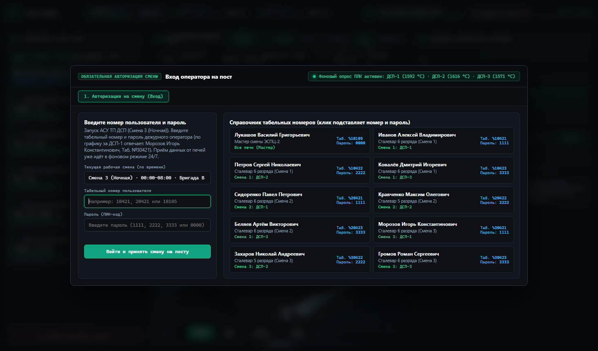
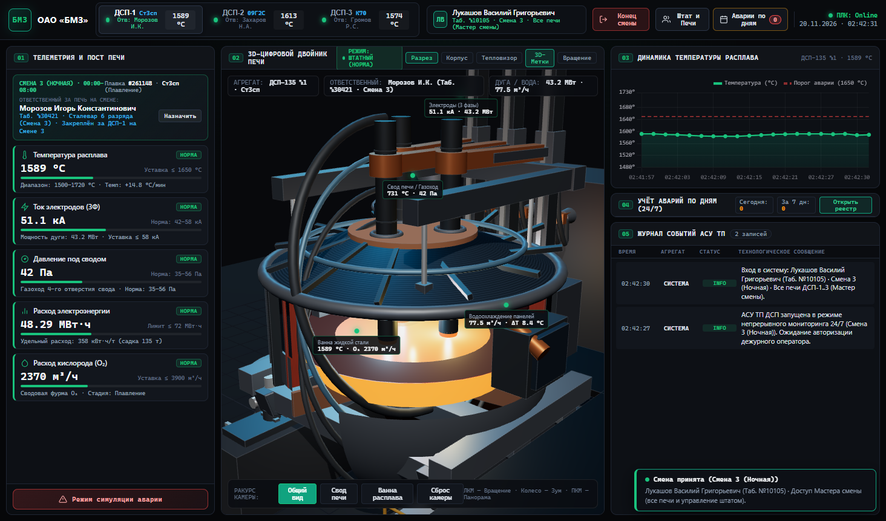
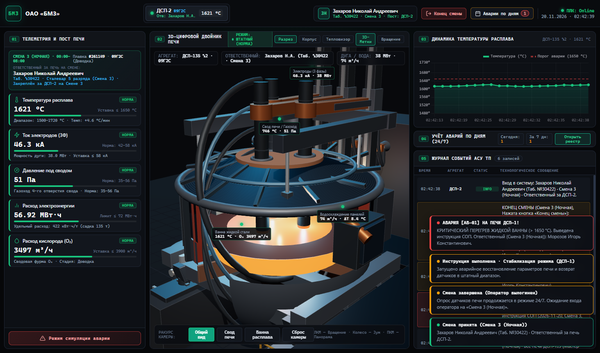
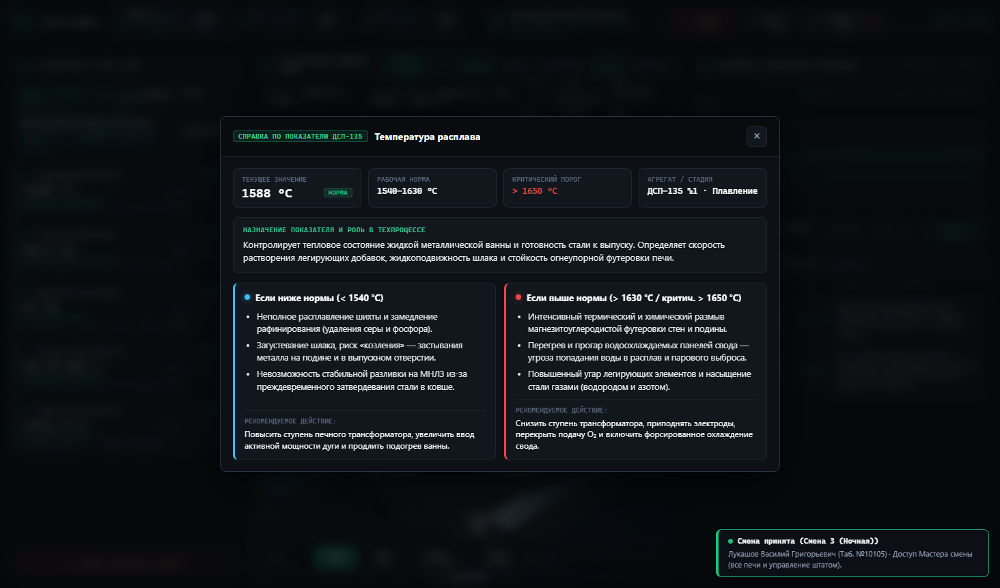
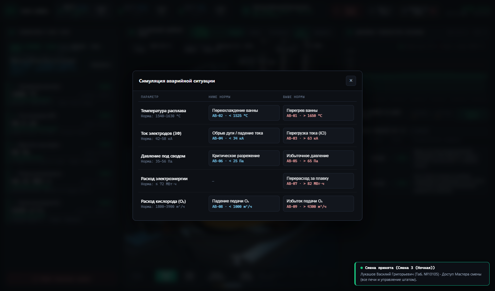
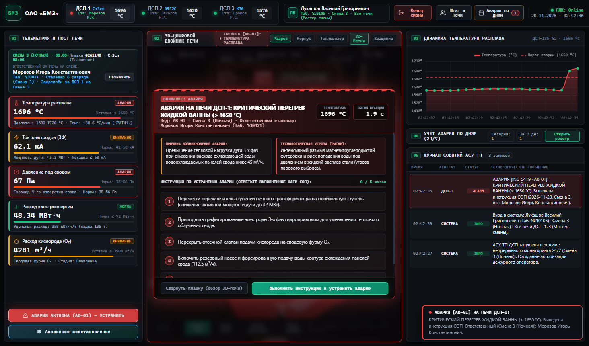
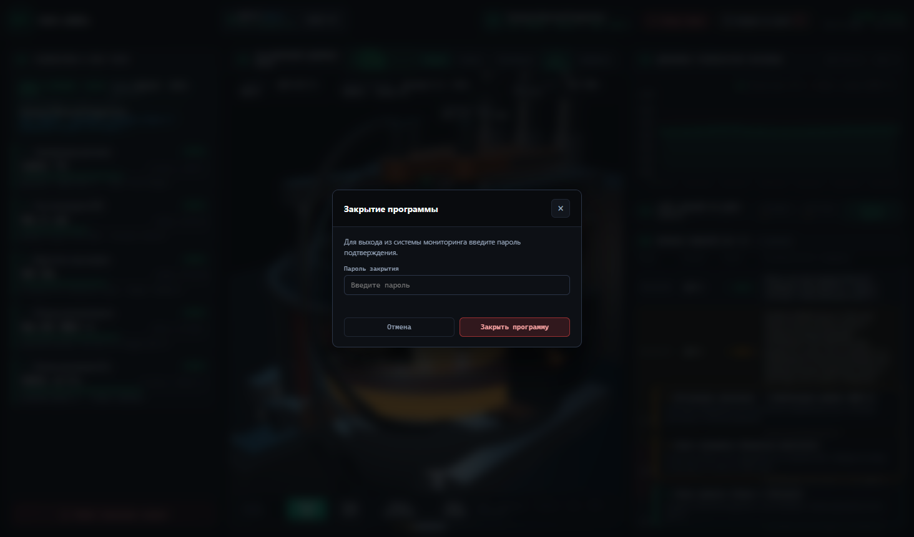

# ОАО «БМЗ» — Система круглосуточного мониторинга и 3D-контроля дуговых сталеплавильных печей ДСП-135 (24/7 SCADA / HMI)

Десктопное приложение класса **SCADA / HMI**, созданное мной для круглосуточного мониторинга технологических параметров, сменного контроля персонала и отработки действий при нештатных ситуациях на дуговых сталеплавильных печах **ДСП-135 (ДСП-1, ДСП-2, ДСП-3)** электросталеплавильного цеха №2 (**ЭСПЦ-2 ОАО «БМЗ»**).

---

## Зачем была создана эта программа

На реальном сталеплавильном производстве оператор (сталевар) и мастер смены работают с десятками критических параметров в режиме **24/7**: температура жидкой ванны, фазный ток электродов, давление газов под сводом, расход электроэнергии и кислорода. Ошибка реакции или промедление при отклонении параметров (как в большую, так и в меньшую сторону) грозит прогаром водоохлаждаемых панелей, «козлением» печи, обломом электродов или выбросом шлака.

Я разработал эту программу как **полноценный прототип автоматизированного рабочего места (АРМ) и интерактивного тренажёра оператора ДСП-135**, который решает сразу несколько практических задач:
- **Наглядный контроль в реальном времени:** объединяет показания 5 ключевых датчиков, живой график температуры и интерактивный **3D-цифровой двойник печи** (`Three.js` + `dsp135.glb`).
- **Разграничение прав и сменная дисциплина:** рабочая смена определяется строго по системному времени (`08:00–16:00`, `16:00–00:00`, `00:00–08:00`), сталевар видит только закреплённую за ним печь, а мастер смены имеет доступ ко всем трём печам и управлению штатом.
- **Обучение и отработка ЧС:** встроенный справочник по каждому показателю (что произойдёт ниже и выше нормы) и **9 сценариев аварий** (высокие и низкие отклонения) с пошаговыми инструкциями СОП и таймером времени реакции.
- **Защита рабочего поста 24/7:** фоновый опрос ПЛК не прерывается при пересменке, а закрытие самой программы защищено паролем (`0000`).

---

## Обзор интерфейса и возможностей (скриншоты)

### 1. Обязательная авторизация на смену и фоновый опрос ПЛК
При запуске программы (и после нажатия «Конец смены») пульт блокируется окном входа. Текущая смена определяется **автоматически по системному времени** без возможности ручного переключения. Пока оператор вводит табельный номер и ПИН-код, программа не останавливает приём телеметрии — в шапке окна отображается живой тикер температур всех трёх печей.



---

### 2. Рабочее место Мастера смены (полный контроль ДСП-1..3)
При входе под **Мастером смены** открывается полный доступ:
- В верхней панели доступны все 3 печи (`ДСП-1`, `ДСП-2`, `ДСП-3`) и кнопка **«Штат и Печи»** для редактирования сотрудников (включая смену самого системного мастера) и матрицы закрепления по сменам.
- В центре работает интерактивный **3D-цифровой двойник печи** (`Разрез`, `Корпус`, `Тепловизор`, `3D-Метки`, `Вращение` и пресеты камеры).
- Справа расположены живой график температуры (`Chart.js`), компактная сводка **«Учёт аварий по дням (24/7)»** с переходом в реестр и **Журнал событий АСУ ТП**. Предустановленных тестовых аварий нет — все записи появляются только по факту возникновения или симуляции ЧС.



---

### 3. Рабочее место сталевара (режим 1 печи)
Когда в систему входит сталевар или подручный, интерфейс автоматически ограничивается его зоной ответственности:
- В шапке отображается **только 1 печь**, за которой закреплён сотрудник (переключение на чужие печи заблокировано).
- Кнопки управления персоналом (**«Штат и Печи»** и **«Назначить»**) скрыты и доступны исключительно мастеру смены.



---

### 4. Интерактивная справка по каждому показателю
Клик по любой из 5 карточек датчиков открывает подробную инженерную справку с текущим значением (обновляется в реальном времени), рабочей нормой, критическим порогом и разбором последствий: **что произойдёт, если показатель упадёт ниже нормы или поднимется выше нормы**, а также рекомендуемые действия оператора.



---

### 5. Выбор аварийного сценария (высокие и низкие отклонения)
По нажатию **«Режим симуляции аварии»** открывается таблица из 5 параметров и **9 сценариев ЧС** — на каждый датчик предусмотрены реальные аварийные ситуации как при превышении, так и при падении показателя ниже нормы:
- **Температура расплава:** перегрев ванны (`АВ-01`, `> 1650 °C`) и переохлаждение с риском «козления» (`АВ-02`, `< 1525 °C`).
- **Ток электродов (3Ф):** перегрузка тока / КЗ шихты (`АВ-03`, `> 63 кА`) и обрыв дуги (`АВ-04`, `< 34 кА`).
- **Давление под сводом:** избыточное давление и выбивание газов (`АВ-05`, `> 65 Па`) и критическое разрежение / подсос воздуха (`АВ-06`, `< 25 Па`).
- **Расход электроэнергии:** перерасход за плавку (`АВ-07`, `> 82 МВт·ч`).
- **Расход кислорода (O₂):** падение подачи / засорение фурмы (`АВ-08`, `< 1000 м³/ч`) и избыток O₂ с риском выброса шлака (`АВ-09`, `> 4300 м³/ч`).



---

### 6. Аварийный режим и пошаговая инструкция СОП
После активации аварии 3D-модель печи и график температуры переходят в тревожное состояние, а поверх сцены открывается карточка **СОП** с причиной аварии, технологическими рисками, секундомером реакции и интерактивным чек-листом из 5 шагов. Инцидент автоматически заносится в журнал событий и суточный реестр с привязкой к текущему ответственному сталевару.



---

### 7. Защита закрытия программы по паролю
Чтобы исключить случайное закрытие системы мониторинга на рабочем посту, попытка закрыть окно (крестик или `Alt+F4`) перехватывается в главном процессе Electron и требует подтверждения паролем **`0000`**.



---

## Архитектура и технологический стек

Приложение построено на **Electron** + **Vanilla JavaScript (ES6 Modules)** по модульному паттерну **MVP (Model – View – Presenter)** без тяжёлых UI-фреймворков:

- **Слой Model (`src/model.js`, `src/mvp/models/`):**
  - `telemetryModel.js` — теплофизическая модель 3 печей, двусторонние пороги (нижние и верхние), физика 9 аварийных сценариев и стабилизации, справочник показателей.
  - `authShiftModel.js` — автоматическое определение смен по системному времени, авторизация, штат сотрудников и матрица закрепления `3 смены × 3 печи`.
  - `incidentsModel.js` — каталог инструкций СОП (`АВ-01`..`АВ-09`), журнал событий и суточный реестр аварий.
- **Слой View (`src/view.js`, `src/mvp/views/`):**
  - `telemetryView.js` — шапка, 5 интерактивных карточек датчиков, окно справки по показателю, живой график `Chart.js`, журнал событий.
  - `furnace3DView.js` — 3D-сцена `Three.js` (`models/dsp135.glb`), `OrbitControls`, процедурные материалы, 3D-метки и аварийная подсветка.
  - `authShiftView.js` — модальное окно входа, матрица ответственных, редактирование/добавление/удаление сотрудников.
  - `incidentsView.js` — таблица выбора аварий, оверлей СОП и реестр аварий по дням.
- **Слой Presenter (`src/presenter.js`, `src/mvp/presenters/`):** координация между Model и View, разграничение прав доступа, секундный цикл обновления `24/7`.
- **Главный процесс Electron (`main.js`, `preload.js`, `modules/`):** постоянное JSON-хранилище (`data/bmz-scada-state.json`), безопасный IPC-мост (`contextBridge`) и перехват закрытия окна с проверкой пароля.

---

## Тестовые учётные записи

*(В окне входа можно кликнуть по карточке сотрудника справа — табельный номер и пароль подставятся автоматически).*

| Табельный № | Пароль | ФИО сотрудника | Должность | Доступ |
| :---: | :---: | :--- | :--- | :--- |
| **`10105`** | **`0000`** | **Лукашов Василий Григорьевич** | Мастер смены ЭСПЦ-2 | Все печи (`ДСП-1..3`), «Штат и Печи» |
| **`10421`** | **`1111`** | Иванов Алексей Владимирович | Сталевар 6 разряда | Смена 1 → `ДСП-1` |
| **`10422`** | **`2222`** | Петров Сергей Николаевич | Сталевар 6 разряда | Смена 1 → `ДСП-2` |
| **`10423`** | **`3333`** | Ковалёв Дмитрий Игоревич | Сталевар 6 разряда | Смена 1 → `ДСП-3` |
| **`20421`** | **`1111`** | Сидоренко Павел Петрович | Сталевар 6 разряда | Смена 2 → `ДСП-1` |
| **`20422`** | **`2222`** | Кравченко Максим Олегович | Сталевар 5 разряда | Смена 2 → `ДСП-2` |
| **`20423`** | **`3333`** | Беляев Артём Викторович | Сталевар 6 разряда | Смена 2 → `ДСП-3` |
| **`30421`** | **`1111`** | Морозов Игорь Константинович | Сталевар 6 разряда | Смена 3 → `ДСП-1` |
| **`30422`** | **`2222`** | Захаров Николай Андреевич | Сталевар 5 разряда | Смена 3 → `ДСП-2` |
| **`30423`** | **`3333`** | Громов Роман Сергеевич | Сталевар 6 разряда | Смена 3 → `ДСП-3` |

> Пароль для закрытия приложения: **`0000`**.

---

## Установка и запуск

```bash
git clone https://github.com/Xa3Rus/bmz-dashboard.git
cd bmz-dashboard
npm install
npm start
```
